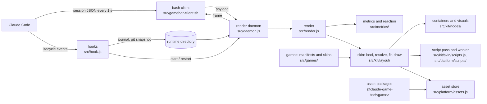

# Architecture

How claude-game-bar turns a Claude Code session into a game HUD. This is the map for contributors;
the user-facing behaviour is in the [README](../README.md), the skin format, the script interface
and the release steps are in [CONTRIBUTING.md](../CONTRIBUTING.md).

## The idea in one paragraph

The bar has one general part, the **platform**, and **games** that are only data. The platform reads
the session, turns it into raw metric values and a game-neutral reaction, and draws a **skin**: a
tree of shared nodes (containers and metric visuals) described in TOML. A game brings a manifest,
one skin file of named skins and an npm package of assets (images, scripts, conversation
libraries). One game, the one-row `default` game, ships inside the bar and is drawn when nothing
is chosen. Nothing in the platform names a game; it finds games
through the registry, and `test/games/general-part.test.mjs` fails when a game's name appears in
`src/` outside `src/games/` or in `bin/`.



## Repository layout

```
bin/cli.js            the claude-game-bar command: install, uninstall, skin, test-card
src/                  the platform, and the game data that ships with it
  statusline.js       the one-shot statusLine command (no daemon, no scripts)
  gamebar-client.sh   the bash client the statusLine runs where bash 5 or Git Bash exists
  daemon.js           the render daemon, one per installation
  hook.js             the hook entry: event journal, git snapshot, daemon supervision, sweeps
  render-core.js      the render the one-shot command and the daemon share
  render.js           renderSession: the render with the skin's scripts, for the daemon
  skin-select.js      which skin a session draws
  skin-assets.js      the assets a skin needs, for install and `skin <name>`
  theme.js            the older theme choice, kept for setups from before skins
  package-root.js     the package root every path and the install hash come from
  platform/           runtime directory, env settings, journal, frame file, daemon supervision,
                      sweep, reaper, git and MSYS snapshots, the asset store, the script worker
  metrics/            the metric catalogue, raw metric values, the bounded formatters (format.js),
                      the game-neutral reaction
  kit/                drawing: layout/ (skin loader, variables, expressions, resolve, fit, draw),
                      nodes/ (containers and visuals), skin/ (script pass, warning line), the chat
                      library, colours, the glyph raster
  install/            settings, the statusLine command, daemons, the old package, the emoji font
  games/              the registry (index.js) and one data folder per game:
    <game>/game.toml  the manifest
    <game>/<game>.toml  the game's skins, as named entries of one file
    default/          the built-in one-row game drawn when nothing is chosen
packages/<game>/      the npm package @claude-game-bar/<game>: images, scripts, conversations
                      (not part of the main package; see packages/README.md)
test/                 one runner (scripts/run-tests.mjs) for every *.test.mjs; e2e on its own
scripts/              development tools: the test runner, face comparison, cost measurements
tools/                user-facing helpers shipped with the package (fix-msys.cmd)
docs/                 this file, plans, ideation, the old backlog's ID map
```

## One tick

Claude Code runs the `statusLine` command about once a second and pipes the session JSON into it.

1. **The client** (`src/gamebar-client.sh`) uses bash builtins only and starts no process. It
   writes the session's payload for the daemon and prints the frame the daemon last rendered for
   this session, greyed with `OFFLINE` when the frame is past its deadline.
2. **The daemon** (`src/daemon.js`) renders every active session of its installation, renews each
   frame's deadline about twice a second, runs at below-normal priority and exits after
   `GAMEBAR_DAEMON_IDLE_MS` with no active session, or when its own source files change; in that
   case, while a session still uses the bar, it starts its successor from the new source itself.
3. **The render** (`src/render-core.js`, with scripts through `src/render.js`):
   1. picks the session's skin (`src/skin-select.js`): the session's `GAMEBAR_SKIN`, the saved
      choice, the older theme, or the default game's default skin;
   2. builds the metric values (`src/metrics/`) from the payload, the hook's journal and git
      snapshot, and system metrics from Node built-ins, with the rate limits pooled across the
      sessions of one Claude account (`src/metrics/ratelimits.js`, the account from
      `src/platform/account.js`); and the game-neutral **reaction**
      (`src/metrics/reaction.js`): what just happened, how long ago, how hurt the player is;
   3. loads the skin's entry (`src/kit/layout/load.js`), skipping and reporting any part that does
      not hold, and resolves it for this render (`src/kit/layout/resolve.js`): every expression
      evaluated against the game's variables and the metric values, colours inherited, and what has
      nothing to show marked;
   4. fits it (`src/kit/layout/fit.js`) to the terminal's width and to a third of its rows: every
      node shrinks toward its minimum; then, at the smallest container that overflows, decoration
      goes, optional nodes drop by priority, inner switches move on, and only then the enclosing
      switch takes its next case (the tall DOOM bar, then the balanced, compact and line bars);
   5. runs the scripts (`src/kit/skin/scripts.js`) of the nodes that stay, all of a session's in
      one batch;
   6. draws (`src/kit/layout/draw.js`) each node by its kind at the size the fit gave it, and adds
      the warning line under the bar when something needs the user's attention.

Where no suitable bash exists (macOS with its own bash 3.2, Windows without Git Bash) the
`statusLine` is the **one-shot** renderer `node src/statusline.js`: the same render without the
daemon and without scripts, so a sprite shows its default frame and a chat plays only the
platform's conversations.

### The client per platform

- **Windows with Git Bash**: the installer writes
  `GAMEBAR_ROOT_HASH=<install hash>; f="<package>/src/gamebar-client.sh"; if [ -r "$f" ]; then . "$f"; else echo 'gamebar: offline'; fi`,
  which sources the client into the bash Claude Code already starts for each tick. The daemon is a
  single instance through the named pipe `\\.\pipe\gamebar-<install hash>`.
- **Linux and macOS with bash 5**: Claude Code runs the statusLine through `/bin/sh` (dash on
  Debian), so the installer writes
  `b='<bash>'; f='<package>/src/gamebar-client.sh'; if [ -r "$f" ] && [ -x "$b" ]; then unset BASH_ENV; exec "$b" --norc --noprofile "$f" <install hash>; else echo 'gamebar: offline'; fi`.
  A tick costs about as much as starting bash: 3 ms on a GitHub Actions Linux runner, against 40 ms
  there for the one-shot renderer (about 250 ms on a Raspberry Pi 5). The daemon is a single
  instance through the socket file `gamebar_daemon_<install hash>.sock` in the runtime directory; a
  socket left by a daemon that was killed is taken over by the next one.
- The one-shot command keeps working where the client is used, so sessions opened before an upgrade
  keep their bar until Claude Code restarts them. Upgrading the package in place updates the client
  without touching `settings.json`.

The runtime directory, the daemon's heartbeat and the per-session files are described in the
README under [Where the files live](../README.md#where-the-files-live) and
[Troubleshooting the daemon](../README.md#troubleshooting-the-daemon).

## Hooks

`src/hook.js` is an append-only event recorder, wired to Claude Code's lifecycle hooks (all in exec
form). It appends each event to the session's journal, and the render folds the journal into the
session state (`src/platform/journal.js`): the last expression with its decay, tool-run intervals
for the activity geiger, the running subagents, the tasks, the error count. Neither side waits for
the other. The hook also:

- takes the git snapshot, so the render path never starts a child process;
- supervises the daemon: starts a missing one, replaces one that stayed hung or outdated past the
  grace period, at most once per throttle window, and leaves a daemon alone while the machine is
  too busy to tell starved from hung (`src/platform/supervise.js`);
- deletes a session's files at `SessionEnd`, and at `SessionStart` sweeps what sessions that ended
  without it left behind (`src/platform/sweep.js`);
- on Windows, reaps hung Git Bash statusLine wrappers (`src/platform/reap.js`; see the README's
  Windows section for why).

When two installations are wired (a global install and a checkout with `install --local`), the
hooks of the installation that does not draw the session step aside, so each event is counted once.

## Skins and nodes

A game's skin file is a tree of nodes, each a table with a `kind`, and named skins that are entry
points into it (`[skin.doom]`, `[skin.doom-line]`). The design, with its reasons and worked
examples, is `docs/ideation/2026-11-20-skin-component-system.md`; the format is in CONTRIBUTING.md,
*Skins*.

- **Containers** lay children out: `anchor` (nine places around a centre that stays exactly in the
  middle), `list`, `box` (a list with a title, fill and border), `grid` (equal cells, lines drawn
  from the arms that are there, any number of selected cells), `layers` and `switch` (alternatives
  by condition and by room).
- **Leaves**: `label`, and the visuals `text`, `number`, `bar`, `meter`, `state`, `sparkline`,
  `columns`, `scroll`, `chat` and `sprite`, each binding a metric from the catalogue
  (`src/metrics/catalogue.js`).

Every node answers one size contract: its minimum, natural and largest width and its rows. A visual
takes its width from its value's type, through the bounded formatters (`src/metrics/format.js`),
never from the current value, so a value never moves the bar. Each kind is a descriptor in
`src/kit/nodes/` that lists its parameters (meaning, type, default, allowed values) and how it
measures and draws. A new kind, such as a minimap, is platform work there, and every game can use
it. Any parameter may be an expression over the game's variables and the metric values
(`src/kit/layout/expr.js`), parsed by the bar and never run as JavaScript.

Bundled skins live in `src/games/<game>/<game>.toml`; a user's own skins in
`~/.claude/claude-game-bar/skins/<name>/<name>.toml`. A skin may use the assets of any game. Skin
names of releases before 3.0.0 select the entries the games' `[legacy] skins` map them to,
keeping the size they chose (`doom-minimal` starts at the balanced bar).

## Scripts

Any node can name a script that changes how it looks each render (the mugshot's frame, the
hotbar's selected slots); a `chat` can name conversation libraries. A node's script state is kept
by its placement path, so an element shared by two switch cases has a state in each. Scripts run only in the daemon,
in one worker thread (`src/platform/scripts/`) with a 64 MB heap: each call has 20 ms, a render pass
has 200 ms for all sessions, a script that throws is off until its file changes and one that runs
late is off for a growing cooldown. A script never changes a node's size. Scripts are trusted
code from the user's skin folders and the installed game packages; the context keeps timers,
`require` and `eval` out of reach but is not a security boundary. The interface is in
CONTRIBUTING.md, *Skin scripts*.

## Game assets

A skin names an asset as `<game>:<path>`. The asset store (`src/platform/assets.js`) resolves it:

1. in a checkout of the repository, from `packages/<game>/`;
2. otherwise from `~/.claude/claude-game-bar/assets/<game>@<version>/`, the one version of
   `@claude-game-bar/<game>` that the game's manifest pins by version and integrity.

A missing pinned package is installed in the background (`npm install --ignore-scripts` with
constant arguments, under a lock, checked against the pinned integrity before it is used); until
then the node draws its default and the warning line names the package. `install` removes
packages no skin used for 30 days. The packages are published from `master` by
`.github/workflows/publish-assets.yml`.

## Glyphs

Images are converted to block glyphs inside the bar (`src/kit/raster/`): a PNG decoder, a
shape-matching renderer and a cache (in memory, and on disk for the one-shot command). The glyph
step (half, quadrant, sextant, wedge, octant) comes from the terminal's identity
(`src/kit/raster/glyph-level.js`), capped per image by the sprite's `glyphs` parameter.
`claude-game-bar test-card` shows which steps a terminal really draws.

## Where the design came from

- `docs/plans/`: the plans of the larger changes, newest last; each starts with its status.
  `2026-11-16-1247-feat-game-as-skin-plan.md` made games data;
  `2026-11-20-1940-feat-skin-component-system-plan.md` is the skin engine of 3.0.0.
- `docs/ideation/`: the explorations behind them; `2026-06-06-doom-statusbar-ideation.md` is the
  original idea of the bar, `2026-11-20-skin-component-system.md` the design of the skin engine.
- Open proposals and bugs: [GitHub Issues](https://github.com/99LevelsUp/claude-game-bar/issues).
  `docs/BACKLOG.md` maps the IDs of the old backlog (D-18, G-5, …) to issues.
