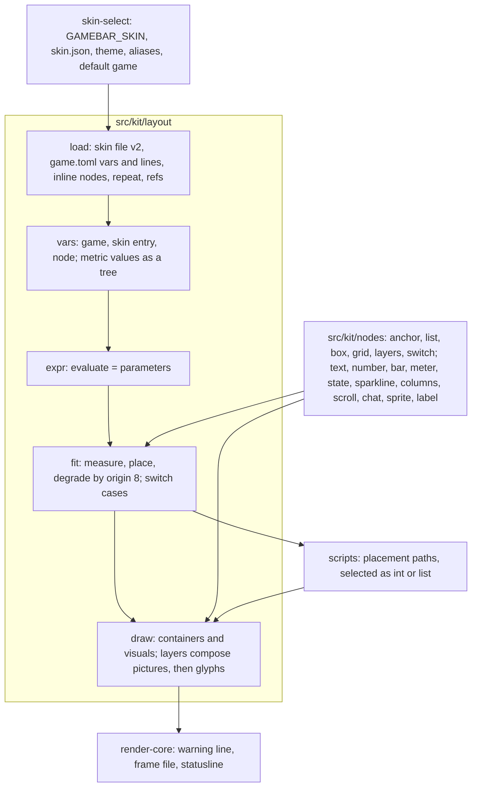
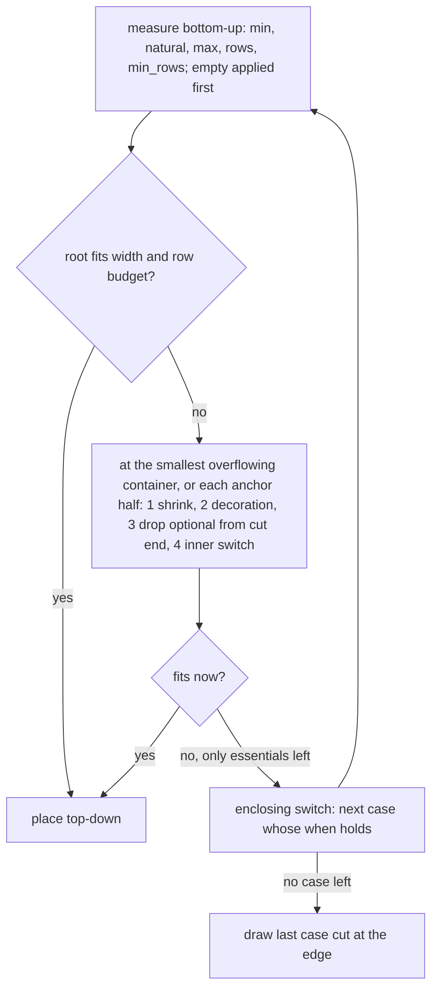
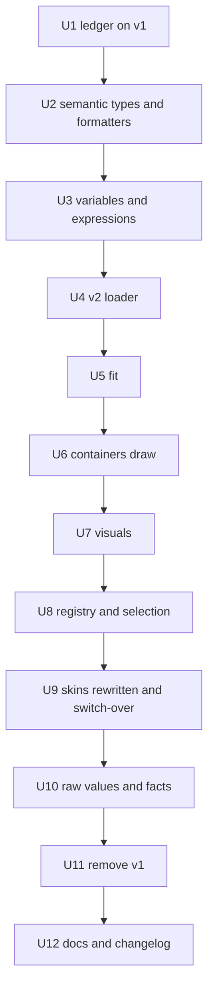

# Skin Component System 3.0.0 - Plan

## Goal Capsule

- **Objective:** A user of claude-game-bar 3.0.0 sees bars that keep the mugshot and the HUD exactly centred and never break a grid or clip a value at any terminal size. A new user with no game chosen gets a working one-line bar on the first run, and a user upgrading from 2.x keeps the skin they chose. Games are written in a small, single-file skin format that a game author can read without knowing the engine.
- **Means:** Rebuild the skin engine on the component model of the origin document. Ship only the parts DOOM, Minecraft and the built-in default game use (KTD1, KTD2).
- **Authority:** the origin document (`docs/ideation/2026-11-20-skin-component-system.md`) owns product behaviour. Its chapter 13 holds the 19 owner-settled decisions. This plan owns the how. Where the two disagree on behaviour, the origin wins. Where they disagree on mechanism, the KTDs here win.
- **Execution profile:**
  - One feature PR from a separate worktree (KTD3). The release follows as the usual `release/3.0.0` PR (`RELEASING.md`).
  - Units land as ordered commits on the feature branch.
  - Master is protected, so the PR merges only with green `test` and `e2e`.
- **Stop conditions:**
  - Stop and ask if the ledger diff in U9 or U10 shows a change that `test/ledger/expected-changes.md` does not predict.
  - Stop and ask if a settled decision proves infeasible.
  - Stop and ask if `e2e` fails for a reason the plan does not cover.
- **Who finishes and ships:** `ce-work` builds and opens the PR; the owner merges it and asks for the release.

---

## Product Contract

### Summary

Replace today's row and column engine with the eight-container component system the origin document specifies, built for 3.0.0 as a clean break of the skin format.
- **What gets built:** only the containers, visuals and rules DOOM, Minecraft and a new built-in one-line default game need.
- **Order of work:** a width and row ledger is recorded on today's engine first, so every later change is a reviewed difference.
- **What stays as it is:** old saved skin names keep working, and the Minecraft asset package does not have to be republished.

### Problem Frame

The skin engine grew without a plan:
- two containers with a centring special case;
- frames that are not containers;
- four vocabularies for width;
- spacer and padding hacks in the skins.

The result is visible to users: the Minecraft hotbar broke at 80 columns (PR #84). The DOOM mugshot drifts off centre when one side is heavy. A skin author has to count columns by hand. The owner reviewed the whole system on 20.11.2026 and settled a replacement (origin, chapters 1–14).

### Key Decisions

All are owner-settled in the origin document, chapter 13. This plan carries them forward; it does not reopen them.

- **Exact centre** (origin decisions 1, 18) — Governs R1, R2.
- **The hotbar is a `grid` container** (decisions 2, 8) — Governs R4.
- **One skin file per game, with a root `switch` instead of the `smaller` chain** (decision 3) — Governs R7, R13.
- **Semantic value types and bounded formatters** (decision 4) — Governs R10, R11, R12.
- **A clean break of the skin format** (decision 5) — Governs R15.
- **Inline nodes, shared ids and `repeat`** (decision 6) — Governs R14.
- **Expressions everywhere** (decision 15) — Governs R9.
- **3.0.0 builds what its three games use; the rest stays specified** (decision 19) — Governs the Scope Boundaries.
- **Saved skin names map to the new skins** — Governs R16. (session-settled: user-approved — chosen over breaking saved choices along with the format: a format break should not cost users their chosen skin)
- **Users with no saved choice get the default game** — Governs R17. (session-settled: user-approved — chosen over keeping DOOM as the implicit default: principle 5 of the origin makes the built-in one-line game the first state)
- **The Minecraft asset package is not republished for 3.0.0** — Governs R5. (session-settled: user-approved — chosen over releasing `@claude-game-bar/minecraft` with a list-returning highlight script: the grid accepts both forms)

### Requirements

**Layout and containers**
- R1. The bar's root fills the bar's width `W`: `COLUMNS` minus `GAMEBAR_INDENT`, as today (`src/render-core.js:47-48`). Under `balance = "mirror"`, the anchor's centre starts at column `⌊(W − centre) / 2⌋` of the bar at every width the skin fits (origin §3.1, §8).
- R2. Each side of a mirrored anchor degrades inside its own half: it shrinks, simplifies decoration, then drops optional nodes from its cut end. The centre never moves (origin §3.1, §8).
- R3. The engine provides `anchor`, `list`, `box`, `grid`, `layers` and `switch`, with the parameters the three games use (origin §3).
- R4. A grid's cells have equal width and height, shrink together, and draw line joints from the arms that are present. Any number of cells can be selected, and lines and selection have their own colours (origin §3.4).
- R5. A grid accepts its script's `selected` as one index or as a list of indices or ids, so the published Minecraft highlight script keeps working (KTD8).
- R6. In `layers`, picture layers compose first and glyph layers are stamped over them. A glyph keeps the background of what is under it (origin §3.5).

**Degradation and the shared contract**
- R7. Every node reports `width`, `min_width`, `max_width`, `grow`, `rows` and `min_rows`. Degradation follows the one order of origin §8 for columns and rows alike, and a `switch` picks the first case whose condition holds and whose node fits (origin §2, §3.6, §8).
- R8. A node without `priority` is never dropped on its own. `empty` (`collapse`, `blank`, `zero`, `full`) and `empty_when` replace `when_absent` and `when_empty` (origin §2).
- R9. Any parameter may be an expression (`=` prefix) over game variables and metric values. `$width` and `$rows` exist only in a switch's conditions. A malformed expression is reported and its parameter keeps its default (origin §7.2).

**Values and formatting**
- R10. Each metric in the catalogue has a semantic type, and a visual takes its natural and minimum width from that type (origin §6.1).
- R11. The bounded formatters for `count`, `money`, `duration`, `time`, `ratio` and `percent` never exceed their type's natural width (origin §6.1).
- R12. Money, durations, the clock, the task ratio and the token savings reach the bar as raw values. The chat's facts stay display strings of the same shape, so the published Minecraft conversations are unaffected (origin §6.1).

**Skins and games**
- R13. Each game has one skin file with named skin entries. DOOM has the alternatives `tall`, `balanced`, `compact` and `line`, and Minecraft has one tree (origin §10, §11.1, §11.2).
- R14. The loader supports inline nodes, shared ids with per-placement identity, references with `vars`, and `repeat` (origin §3.7, §10).
- R15. A skin file in the old format fails to load with a warning. The bar then draws the default game; there is no adapter (origin decision 5).
- R16. The old skin names (`doom-full`, `doom-standard`, `doom-minimal`, `doom-compact`, `doom-line`, `minecraft-compact`) still select a skin, wherever they are saved: in `skin.json`, in `GAMEBAR_SKIN`, through a `GAMEBAR_PRESET` resize, or in the theme file. A name that chose a smaller size keeps that size as its largest (KTD9).
- R17. A built-in one-line default game, compiled into the bar and named `default`, is drawn when no game is installed or chosen (origin principle 5, §11.3).

**Verification**
- R18. A ledger of what every bundled skin draws at widths 40–250 and row budgets 1–8 is recorded on today's engine. Every difference under the new engine is either on the expected-change list or a defect (origin §12 step 1).
- R19. The guarantees of origin §8 are tested on every bundled skin:
  - the root is never wider than the terminal, except in the reported cut case;
  - the centre is exact under `mirror`;
  - the cells of a grid are equal;
  - the same values and size give the same drawing.

### Success Criteria

- The PR #84 failure cannot be reproduced: the Minecraft hotbar's slots are equal at every width from 40 to 250 columns.
- The DOOM mugshot's first column in the bar equals `⌊(W − 12) / 2⌋` (R1) at every width where the tall or balanced bar is drawn.
- A user who chose a smaller DOOM size in 2.x (`doom-minimal`, `doom-compact`, or a preset) still gets that size or smaller after the upgrade, never a taller bar.
- A fresh install with no saved choice draws the default game on the first render, offline.

### Scope Boundaries

- Not built in 3.0.0; specified in the origin and built with the first game that needs it:
  - `each`, `trend`, vertical `bar` and `meter`, gradient `fill`, `currency` (The Sims);
  - `marks`, draw scripts, `shared`, the before script, `joined`, pattern and image frames with overhang (WC3);
  - a computed `value` with a `type`, user skins with `base`.

  The parts built now keep room for them (origin §12).
- Chrome leaves `rule` and `image` are not built: no 3.0.0 skin uses them.
- Not touched: the old environment names and fallbacks (`DOOMBAR_*`, `GAMEBAR_PRESET`, `GAMEBAR_THEME`, the old theme file). They remain as today, and their removal is issue #45.
- Not touched: the published asset packages (`@claude-game-bar/doom`, `@claude-game-bar/minecraft`).
- Not built: the default game's npm entry and an npm game list (issue #76; origin chapter 15).
- Considered and not built: an adapter that loads old-format skins. The owner chose a clean break, and no third-party skins are known. A user skin in the old format falls back with a warning (R15). Evidence of third-party skins in use would justify a one-off conversion script.

#### Deferred to Follow-Up Work

- Switch the Minecraft highlight script to return a list, and publish and pin a new `@claude-game-bar/minecraft` (two PRs, `CONTRIBUTING.md` asset steps). The grid accepts both forms meanwhile.

### Dependencies

- `smol-toml` 1.6.1 already parses the TOML 1.1 inline tables and `cases` syntax the format uses. A scratch check was made during research.

### Sources

- Origin: `docs/ideation/2026-11-20-skin-component-system.md` (chapters 2–14; open questions in chapter 15).
- Code map: the selection order (`src/skin-select.js`) and the pipeline (`src/render-core.js`).
- Today's fit and its special cases:
  - the root centre at `src/kit/skin/fit.js:211-214`;
  - the `smaller` chain at `src/kit/skin/fit.js:186-209`.
- Grid joint logic: `src/kit/elements/containers.js:225-253`.
- Script state keyed by element id: `src/kit/skin/scripts.js:171,186,236`.
- Snapshot mechanism: `test/games/render-snapshot.test.mjs` (`WIDTHS` at `:56`).

---

## Planning Contract

### Key Technical Decisions

- KTD1. **The new engine lives beside the old one until the switch-over, then replaces it.**
  - New modules go in `src/kit/nodes/` (containers and visuals) and `src/kit/layout/` (loader, variables, expressions, fit, draw).
  - `src/render-core.js` switches to them in U9, the unit that lands the new skins.
  - U11 deletes `src/kit/elements/` and the old `load.js`, `fit.js` and `draw.js`.
  - Building beside the old engine keeps every commit drawable and the test suite meaningful until the switch-over. The live bar, the snapshot suite and every skin-format test depend on the old engine (research R1).
- KTD2. **Build scope follows origin decision 19.** Each container or visual is built only when a 3.0.0 skin uses it. The parameter tables keep the specified-but-unbuilt names reserved:
  - the loader reports them as "not available in this version";
  - it does not report them as unknown.

  That keeps the door open (origin §12) without dead code.
- KTD3. **One feature PR, worked in a separate worktree.**
  - The live bar runs from the main checkout and restarts on every `src/` change, so the work happens in a worktree off `origin/master` (for example `D:\Smeti\Dev\Claude\cgb-v3`). That keeps the live bar on master until the merge.
  - The project requires a PR per change but no person-review size limit, so the units ship as ordered commits in one PR.
  - The release is the project's separate `release/3.0.0` PR (`RELEASING.md`).
- KTD4. **Expressions are parsed by a small hand-written evaluator, never by JavaScript.**
  - A tokenizer and a precedence parser compile each `=` string once at load.
  - Evaluation reads a frozen variable tree and has no access to globals.
  - Malformed text becomes a load warning, and the parameter falls back to its default (R9).

  This rules out code injection from skin files: skins come from npm packages and user folders.
- KTD5. **Placement identity is a path; scripts still see element ids.**
  - A node placed several times (shared ids, `repeat`, switch cases) gets a placement path such as `tall/left-side/usage`. Script state, script outputs and warnings are keyed by that path.
  - Scripts receive `children[].id` as the element id. The Minecraft highlight script finds slots by `slot-errors` and the like (`packages/minecraft/scripts/hotbar-highlight.js:20`).
- KTD6. **The catalogue gains the semantic type as a new field first; it replaces the coarse type at the end.**
  - U2 adds `semantic` beside `type`. Changing `type` while the old loader checks it would skip old elements (research R1).
  - U11 folds `semantic` into `type` and retires the coarse values.
- KTD7. **Producers switch to raw values only after the old visuals are gone.**
  - U10 runs after the switch-over: the old `text` visual would print raw numbers.
  - It changes the producers, the new visuals' formatting and the chat's facts library together.
  - The facts keep their display-string shape (R12).
  - The raw clock is the local time of day in seconds since midnight, computed by the producer. The formatter and `F.hour` then need no time zone, and snapshots recorded on the owner's CET machine match CI in UTC.
  - Subagent items keep their preformatted duration strings: `act.subagents` items are drawn by `scroll` as text, and the origin's types do not cover list items.
  - The two token-savings share metrics are added earlier, in U2, beside the unchanged text values. They are additive, no v1 skin reads them, and the U9 ledger is then recorded with the final metric set.
- KTD8. **The grid accepts `selected` as an integer or a list** (R5).
  - Both forms normalise to a set of child indices.
  - The published highlight script (integer) and a future list-returning script both work. That is why no package release is needed (Key Decisions).
- KTD9. **Old skin names resolve through a manifest alias table to skin entries that keep their size.**
  - The DOOM skin file defines, besides `doom` and `doom-line`, two more entries with the existing switch mechanism and no new one:
    - `doom-minimal`, whose root is a switch over `balanced`, `compact` and `line`;
    - `doom-compact`, whose root is a switch over `compact` and `line`.

    A user who chose a smaller size never gets a taller bar (R16), as v1 started the `smaller` chain at the chosen file.
  - Each `game.toml` gains `[legacy] skins`:
    - `doom-full` and `doom-standard` map to `doom`;
    - `doom-minimal`, `doom-compact` and `doom-line` map to their own entries;
    - `minecraft-compact` maps to `minecraft`, which has no smaller v2 form. U12's CHANGELOG says so.
  - `findSkin` consults the table after the bundled names, before reporting `unknown-skin`. Preset names resolve through the same table.
- KTD10. **The default game is a game folder with no asset package.**
  - It lives in `src/games/default/`, with `default = true` (moved from DOOM) and no `[assets]` table.
  - Tests that assume every game has a package and a mugshot change instead:
    - `test/install/package-files.test.mjs` allows a manifest without `[assets]`;
    - the CLI test card takes its sample image from the first game whose skin has a `sprite`;
    - `test/games/general-part.test.mjs` exempts the built-in default game's name.

  The platform still names no game in code: it finds the default through the manifest flag.
- KTD11. **The ledger records what the user sees, not engine internals.** The signature has to be produced by both engines, because skin names, ids and node widths all change in v2 (origin §12 step 1). Per skin, width and row budget it records:
  - the rows drawn;
  - the box titles left and right of the mugshot;
  - the mugshot's first column;
  - the visible hotbar slots;
  - the clipped flag.

  It runs `fitSkin` and the draw directly, with scripts off, which is about 12k renders.
- KTD12. **A root that does not fill keeps today's outer centring.** An anchor root fills the width, so its outer offset is zero. A `list` root, such as the default game, is centred as today's bars are (`src/kit/skin/draw.js:114`), so the one-line bar does not jump to the left edge.

### High-Level Technical Design

The render pipeline after the switch-over (U9). The new modules are on the left; the unchanged platform is on the right.



The fit, per render:



The work order follows origin §12. The ledger comes first, and the switch-over waits until the new engine can draw every bundled skin:



### Output Structure

```text
src/kit/layout/        load.js  vars.js  expr.js  fit.js  draw.js
src/kit/nodes/         index.js  schema.js  lines.js
src/kit/nodes/containers/  anchor.js  list.js  box.js  grid.js  layers.js  switch.js
src/kit/nodes/visuals/     text.js  number.js  bar.js  meter.js  state.js  sparkline.js  columns.js  scroll.js  chat.js  sprite.js  label.js
src/metrics/format.js
src/games/default/     game.toml  default.toml
src/games/doom/        game.toml  doom.toml          (replaces skins/*.toml)
src/games/minecraft/   game.toml  minecraft.toml     (replaces skins/*.toml)
test/ledger/           <skin>.json
test/layout/  test/nodes/   (new engine tests)
```

### Assumptions

- No third-party skin in the old format is in use. The owner knows of none (origin decision 5).
- The owner's live DOOM bar with no saved choice will switch to the default game after the upgrade. This is intended (R17); the owner's own `skin.json` decides what they see.

### Sequencing

Units run in U-ID order: U1 through U12, the order of the third diagram. U1 must be committed before any engine change, because its golden files are the v1 baseline.

---

## Implementation Units

| U-ID | Title | Files touched | Depends on |
|---|---|---|---|
| U1 | Ledger on today's engine | `scripts/ledger.mjs`, `test/ledger/*`, `test/games/ledger.test.mjs` | — |
| U2 | Semantic types, formatters and share metrics | `src/metrics/catalogue.js`, `src/metrics/format.js`, `src/metrics/savings.js` | U1 |
| U3 | Variables and expressions | `src/kit/layout/vars.js`, `src/kit/layout/expr.js` | U2 |
| U4 | v2 loader | `src/kit/layout/load.js`, `src/kit/nodes/schema.js`, `src/kit/nodes/index.js` | U3 |
| U5 | The fit | `src/kit/layout/fit.js` | U4 |
| U6 | Containers and their drawing | `src/kit/nodes/containers/*`, `src/kit/nodes/lines.js`, `src/kit/layout/draw.js` | U5 |
| U7 | Visuals on the contract | `src/kit/nodes/visuals/*` | U6 |
| U8 | Registry, selection and aliases | `src/games/index.js`, `src/skin-select.js`, `src/theme.js`, `src/skin-assets.js`, `bin/cli.js` | U4 |
| U9 | Skins rewritten and the switch-over | `src/games/*/`, `src/render-core.js`, `src/kit/skin/scripts.js` | U7, U8 |
| U10 | Raw values, formatting and chat facts | `src/metrics/*`, `src/kit/chat/metrics-library.js`, `test/_raw-sample.mjs` | U9 |
| U11 | Remove the v1 engine | `src/kit/elements/`, `src/kit/skin/{load,fit,draw}.js`, old tests | U10 |
| U12 | Docs and changelog | `docs/architecture.md`, `CONTRIBUTING.md`, `README.md`, `CHANGELOG.md` | U11 |

### U1. Ledger on today's engine

- **Goal:** record what every bundled skin draws today at widths 40–250 and row budgets 1–8, as the baseline the new engine is checked against (R18, KTD11).
- **Requirements:** R18.
- **Dependencies:** none. It is the first commit of the branch.
- **Files:**
  - create `scripts/ledger.mjs` (the generator);
  - create `test/ledger/doom.json`, `test/ledger/doom-line.json` and `test/ledger/minecraft.json`;
  - create `test/ledger/expected-changes.md`, the list of intended differences per ledger file (step 5 below);
  - create `test/games/ledger.test.mjs`.
- **Approach:**
  1. Render with `fitSkin` and the draw directly, scripts off, the clock fixed and `step: "octant"`, as the snapshot test does.
  2. Key the files by the entry skins that survive into v2: `doom-full` as `doom`, `doom-line` and `minecraft`. A chain member is reached through its entry's fallback.
  3. Store the signature of KTD11 per width and row budget, compressed into runs of identical signatures so the file shows breakpoints.
  4. The test re-renders and compares. `UPDATE_LEDGER=1` rewrites the files, refused under `CI`, like `UPDATE_SNAPSHOTS`.
  5. Write `expected-changes.md` with the intended differences, so the U9 review can fail:
     - **DOOM:** the mugshot column follows R1; SAVE drops in the left half and SYSTEM, AGENTS and TASKS in the right; the balanced bar replaces doom-minimal; the cost is left out at 3 rows;
     - **Minecraft:** the hotbar's visible slots stay equal.

     Before U9 regenerates the ledger, it adds the predicted width and row budget of each breakpoint, derived from the v2 skins' minimums (U9 step 4).
- **Patterns to follow:** the snapshot test's fixed inputs and refusal under CI (`test/games/render-snapshot.test.mjs:48-60`). The mugshot column regex and `titles()` helper come from `test/games/doom-skin.test.mjs:207`.
- **Test scenarios:**
  - With the files committed, the test passes on today's engine.
  - Changing one DOOM box's `min_width` makes the test fail and name the skin, width and row budget of the first difference.
  - With `CI` set, `UPDATE_LEDGER=1` is refused with a message.
  - At 80 columns today's `doom` entry records the doom-minimal titles, matching `test/games/registry.test.mjs:235-237`.
- **Verification:** the three ledger files exist, and the test passes on master's engine.

### U2. Semantic types and bounded formatters

- **Goal:** give every metric its semantic type and provide one bounded formatter per formatted type (R10, R11, KTD6).
- **Requirements:** R10, R11.
- **Dependencies:** U1.
- **Files:**
  - modify `src/metrics/catalogue.js` (add `semantic` per entry, keep `type`) and `src/metrics/savings.js` (emit the two share metrics);
  - create `src/metrics/format.js`;
  - update `test/_raw-sample.mjs` with the share metrics;
  - tests in `test/metrics/catalogue.test.mjs`, `test/metrics/format.test.mjs` and `test/metrics/statusline-savings.test.mjs`.
- **Approach:**
  1. Map every catalogue id to the type table of origin §6.1.
  2. Add the two share metrics, `save.leanctx.share` and `save.lingua.share`, and emit them beside today's unchanged text values (KTD7).
     - `save.lingua.share` is `last_saved_pct` when present. Otherwise it is `100 × (1 − 1 / last_ratio)`, because llmlingua sometimes reports only a ratio (`src/metrics/savings.js`). It is absent when neither exists.
  3. The formatters take a raw value and a width class (natural or compact) and return text no wider than the type's bound (origin §6.1 formatter rules).
  4. Export each type's natural and minimum width for the visuals.
- **Test scenarios:**
  - `duration` formats 59 s as `59s`, 4 h 59 m as `4h59m`, 23 h 59 m as `23h`, and 6 d 23 h as `6d23h`. Each fits 5 columns.
  - `count` formats 999, 12,345, 123,456 and 1,234,567 as `999`, `12.3k`, `123k` and `1.2M`.
  - `money` formats 12.34, 123.4, 9999 and 12,345 as `$12.34`, `$123`, `$9999` and `$12k`.
  - `ratio` formats [3, 12] as `3/12` and [120, 140] as `99+/99+`, never above 5 columns.
  - Every catalogue id has a `semantic` value from the type list.
  - A lingua file with only `last_ratio: 1.3` gives `save.lingua.share` of 23. A file with neither field leaves it absent.
  - `time` formats 51,780 seconds since midnight as `14:23`.
  - A property-style sweep over values from 0 to 10^9 never exceeds any type's natural width.
- **Verification:** the formatter and catalogue tests pass. Nothing on screen changes, and the ledger is unchanged.

### U3. Variables and expressions

- **Goal:** the variable dictionary of origin §7.1 and the expression language of origin §7.2 (R9, KTD4).
- **Requirements:** R9.
- **Dependencies:** U2.
- **Files:**
  - create `src/kit/layout/vars.js` and `src/kit/layout/expr.js`;
  - tests in `test/layout/vars.test.mjs` and `test/layout/expr.test.mjs`.
- **Approach:**
  1. `vars` layers the game's `[vars]`, the skin entry's `[vars]` and a node's `vars` for its subtree. The before script's layer is left as a reserved slot (KTD2).
  2. It exposes metric values under the catalogue ids. `$a.b.c` resolves by the longest catalogue id that prefixes it, and any remaining segments read fields of that value. So `$save.leanctx` is the count and `$save.leanctx.share` the percent, although one id is a prefix of the other.
  3. `expr` parses once into a tree and evaluates against a vars view. `${name}` interpolates inside strings.
  4. `$width` and `$rows` are allowed only when the caller marks the expression as a switch condition. Elsewhere they are a load warning.
- **Technical design** (directional): a precedence ladder `or` < `and` < `not` < comparison and `in` < `||` < `+ -` < `* / %` < unary < primary, where `case … end` and function calls are primaries.
- **Test scenarios:**
  - `= case when $context.hp > 80 then $bad when $context.hp > 50 then $warn else $good end` picks each branch at 90, 60 and 10.
  - `= 'AGENTS (' || $act.agents || ')'` gives `AGENTS (2)`.
  - `= $act.errors = 0` is true at 0 and false at 1.
  - `has($ratelimit.5h)` is false when the session does not report it.
  - `coalesce($x, 5)` gives 5.
  - `wc3:frames/${race}` interpolates.
  - An unknown name is reported once, and the parameter keeps its default.
  - `= 1 +` fails to parse at load, with a warning naming the element and parameter.
  - `$width` outside a switch condition is a load warning.
  - A skin string containing `process.exit()` is a parse error, never executed.
  - A game variable that tries to define a catalogue id (`context`) is reported.
  - `$save.leanctx` gives the count and `$save.leanctx.share` the percent; `$item.time` reads a field of an item.
- **Verification:** the vars and expression tests pass. No existing module imports them yet.

### U4. v2 loader

- **Goal:** load the single-file skin format of origin §10 into the tree the new fit consumes (R13, R14, R15).
- **Requirements:** R13, R14, R15; KTD2, KTD5.
- **Dependencies:** U3.
- **Files:**
  - create `src/kit/layout/load.js`, `src/kit/nodes/schema.js` and `src/kit/nodes/index.js` (the kind registry, first with containers only);
  - fixtures in `test/fixtures/skins-v2/`;
  - tests in `test/layout/load.test.mjs`.
- **Approach:**
  1. Read `version = 2`, `[skin.<name>]` (root and vars) and `[element.<id>]`. Children may be ids, inline tables or `{ ref, vars }`.
  2. Expand `repeat` with `{placeholder}` substitution at load.
  3. Give inline nodes generated ids (`context.1`).
  4. Validate parameters against each kind's schema. Unknown parameters are reported and ignored. Reserved, unbuilt kinds and parameters get a "not available in this version" warning (KTD2).
  5. A file without `version = 2` is rejected with a warning (R15).
  6. Read `game.toml` `[vars]` and `[lines]`. Cache the parsed result by mtime and size, as `src/kit/skin/load.js` does today.
- **Patterns to follow:** warning causes and `makeWarning` from `src/kit/skin/load.js:41-46` and `src/kit/warning.js`. Schema validation comes from `src/kit/elements/schema.js`.
- **Test scenarios:**
  - A file with two skin entries exposes both, each with its root.
  - An inline child gets id `parent.1` and validates.
  - A `repeat` with three items yields three nodes whose ids come from the items, so `slot-errors` survives.
  - `{ ref = "panel", vars = { accent = "#b03020" } }` yields a placement with that variable scoped to its subtree.
  - An element shared by two switch cases appears in both, with distinct placement paths.
  - A reference to a missing id is reported and skipped.
  - A v1 skin file (no `version = 2`) fails to load with a warning.
  - `kind = "each"` reports "not available in this version", not "unknown kind".
  - A multi-line inline table parses (TOML 1.1).
- **Verification:** the loader tests pass against the v2 fixtures.

### U5. The fit

- **Goal:** measure, place and degrade the loaded tree by origin §8, including anchor side budgets, the row budget and switch cases (R1, R2, R7, R8).
- **Requirements:** R1, R2, R7, R8; KTD12.
- **Dependencies:** U4.
- **Files:**
  - create `src/kit/layout/fit.js`;
  - tests in `test/layout/fit.test.mjs` (with synthetic container descriptors where real ones do not exist yet).
- **Approach:**
  1. Apply `empty` and `empty_when` first.
  2. Measure bottom-up from each kind's `size()`, including stepped kinds.
  3. When the root overflows, degrade at the smallest overflowing container. For a mirrored anchor, each half is its own budget. Follow the order of origin §8: shrink, decoration, optional drops from the cut end, inner switches, then the enclosing switch. Rows use the same steps.
  4. Evaluate switch conditions during placement with `$width` and `$rows` set.
  5. The row budget is `GAMEBAR_MAX_ROWS`, else a third of `LINES` (`src/render-core.js:54-59`).
  6. Place top-down and return the placed tree, with what was dropped and absent and whether it was clipped.
- **Execution note:** write the side-budget and switch-case tests first; they are where the origin's guarantees live.
- **Test scenarios:**
  - **Centre:** a mirrored anchor with a 12-wide centre places it at `⌊(W − 12) / 2⌋` for every W from 40 to 250 where it fits. Covers R1.
  - **Drops stay in their half:** the left half overflowing drops its optional node while the right half's optional node stays. Covers R2.
  - **Essential nodes:** a node without priority is never dropped; its container's switch moves on instead.
  - **Cut end:** equal priorities drop from the cut end. With `align = "end"` that is the start.
  - **Inner switch timing:** an inner switch takes its narrow form only after the optional nodes beside it are dropped.
  - **Rows:** a vertical box of five rows with two optional rows fits a 3-row budget by dropping them.
  - **Switch cases:** a `when` false case is skipped even when it fits; a true case that cannot fit falls through to the next.
  - **Cut case:** with no case fitting, the last case is drawn cut and `clipped` is set.
  - **Empty rule:** `empty = "blank"` keeps a node's minimum size with no value; `collapse` gives 0.
  - **Determinism:** the same values and size give an identical placed tree.
- **Verification:** the fit tests pass, including the R1 sweep.

### U6. Containers and their drawing

- **Goal:** the six containers with their parameters and drawing: anchor, list, box, grid, layers and switch (R3, R4, R5, R6).
- **Requirements:** R3, R4, R5, R6; KTD8, KTD12.
- **Dependencies:** U5.
- **Files:**
  - create `src/kit/nodes/containers/{anchor,list,box,grid,layers,switch}.js`, `src/kit/nodes/lines.js` (line sets of 11 characters and the arm-to-glyph table) and `src/kit/layout/draw.js`;
  - tests in `test/nodes/containers.test.mjs`.
- **Approach:**
  1. **Grid lines:** draw from per-segment ownership. A joint's glyph is chosen from the arms that are present, in the selected style when any arm is selected (origin §3.4).
  2. **Grid selection:** normalise `selected` from an integer or a list into a set (KTD8).
  3. **Box:** inherits and passes on `background` (origin §7.3) and degrades its decoration in the §3.3 order.
  4. **Layers:** compose `sprite` layers as pictures before raster. Glyph layers keep the background below them (R6). In 3.0.0 the only picture layer is a frame-based sprite (KTD2).
  5. **Outer centring:** the draw keeps today's outer centring for a non-filling root (KTD12).
- **Patterns to follow:** today's joint logic (`src/kit/elements/containers.js:225-253`), generalised from one selected cell. Paint helpers come from `src/kit/elements/paint.js`, and colours from `src/kit/colors.js`.
- **Test scenarios:**
  - **One selected cell:** a 9×1 grid with cell 2 selected draws `┏` and `┓` at its top joints and plain `┬` elsewhere (origin §3.4 example).
  - **Two neighbouring selected cells:** the shared joint stays `┳` in the selected colour.
  - **Integer or list:** `selected: 2` and `selected: ["slot-cost"]` select the same cell; `selected: null` selects none.
  - **Equal cells:** a grid whose children have different minimums draws all cells at the widest minimum when short of room. Covers R4.
  - **Box decoration order:** a bordered box short of rows loses its border before any child.
  - **Inherited background:** a box with `fill = "$panel"` draws its children's separators on the panel colour.
  - **List between:** two meters with `align = "between"` sit at the list's two edges.
  - **Glyph over glyph:** a number over a bar keeps the bar's fill background on the filled cells.
- **Verification:** the container tests pass.

### U7. Visuals on the contract

- **Goal:** the visuals the three games use, each reporting the shared size contract and formatting by semantic type: `text`, `number`, `bar`, `meter`, `state`, `sparkline`, `columns`, `scroll`, `chat`, `sprite` (frames) and `label` (R7, R10).
- **Requirements:** R7, R10; KTD2.
- **Dependencies:** U6.
- **Files:**
  - create `src/kit/nodes/visuals/*.js`;
  - tests in `test/nodes/visuals.test.mjs`.
- **Approach:**
  1. Port each visual's drawing from `src/kit/elements/*.js` under its new name. The renames are in origin §5.
  2. Replace per-kind width parameters with the shared contract. `number` and `state` gain minimums.
  3. `bar` takes `fill_glyph` and `empty_glyph`.
  4. Width defaults come from the metric's semantic type via `src/metrics/format.js`. Values still arrive preformatted until U10, so a visual draws a string value as text.
  5. `sprite` supports frames only: `draw` is reserved (KTD2). It measures through the asset resolver, as today (`src/render-core.js:132-134`).
- **Patterns to follow:** each `src/kit/elements/<visual>.js` and its tests in `test/kit/elements.test.mjs`.
- **Test scenarios:**
  - A `number` of type `percent` measures 4 natural and 3 minimum, and draws `100%` at 4 and `100` at 3.
  - A `text` of type `duration` with no `width` measures 5 and 2.
  - A `bar` of 8 cells at 48% fills 3 cells plus a partial.
  - A `meter` of 10 hearts at 55% with `invert` draws the remaining share.
  - `state` for effort `high` draws its moon icon at its fixed width; for flags it draws one icon per flag.
  - `sprite` with frames measures the largest frame at its rows, as `src/kit/elements/animation.js` does today.
  - Each visual draws exactly the width it was given, from minimum to natural.
- **Verification:** the visual tests pass. Every kind used by the origin's DOOM, Minecraft and default examples exists.

### U8. Registry, selection and aliases

- **Goal:** the registry reads one skin file per game with several entries, old skin names resolve, and the default game is found through its manifest (R16, R17).
- **Requirements:** R16, R17; KTD9, KTD10.
- **Dependencies:** U4.
- **Files:**
  - modify `src/games/index.js` (skin entries from v2 files; `[legacy] skins` aliases), `src/skin-select.js` (aliases before `unknown-skin`), `src/theme.js`, `src/skin-assets.js` (walk switch cases, inline nodes and refs instead of the `smaller` chain) and `bin/cli.js` (skin list and `next` over entries; test card image per KTD10);
  - v2 fixture games in `test/games/fixture-v2/` and `test/games/fixture-v2-default/`, added to the registry by the tests;
  - tests in `test/games/registry.test.mjs`, `test/games/skin-select.test.mjs`, `test/install/test-card.test.mjs`, `test/install/package-files.test.mjs` and `test/games/general-part.test.mjs`.
- **Approach:**
  1. Keep v1 discovery working until U9 lands the v2 files: the registry recognises both shapes by `version`.
  2. Aliases map every old skin name and preset name to an entry (R16, KTD9).
  3. `defaultGame()` keeps reading the `default = true` flag.
  4. A user skin `skins/<name>/<name>.toml` in v2 draws its `[skin.<name>]` entry, else its first entry.
  5. The mechanisms are tested here against v2 fixture games, which tests may add to the registry (`src/games/index.js`). The bundled games move to v2 only in U9, so the scenarios that need the real DOOM, Minecraft and default files are U9's.
- **Test scenarios** (against the fixture games):
  - **Aliases:** an alias in a fixture manifest's `[legacy] skins` selects its entry through `GAMEBAR_SKIN`, `skin.json` and a `GAMEBAR_PRESET` resize. Covers R16.
  - **Size-keeping alias:** an alias to an entry whose root switch starts at a smaller case draws that case on a wide terminal.
  - **Default flag:** with no saved choice, the fixture game marked `default = true` is selected.
  - **Unknown name:** `ghost` still warns `unknown-skin` and falls back to the default game.
  - **User skins:** a user skin file with `[skin.mine]` named `mine` draws that entry; one without a matching entry draws its first entry.
  - **Package-files test:** passes with a game that has no `[assets]`.
  - **Test card:** takes its image from the first game whose skin has a `sprite`.
- **Verification:** the registry, selection, install and CLI tests pass, and the bundled v1 games still draw as before.

### U9. Skins rewritten and the switch-over

- **Goal:** the three games in the new format, drawn by the new engine end to end (R13, R17, R18, R19).
- **Requirements:** R1, R2, R4, R13, R17, R18, R19; KTD1, KTD5.
- **Dependencies:** U7, U8.
- **Files:**
  - create `src/games/doom/doom.toml`, `src/games/minecraft/minecraft.toml`, `src/games/default/game.toml` and `src/games/default/default.toml`;
  - delete `src/games/*/skins/*.toml`;
  - modify `src/games/doom/game.toml` (drop `default = true`, add `[vars]` and the `[legacy] skins` table of KTD9), `src/games/minecraft/game.toml` (same table), `src/render-core.js` (load, fit and draw through `src/kit/layout/`), `src/kit/skin/scripts.js` (placement paths, element ids for scripts, `selected` passed through) and `src/statusline.js` (one-shot through the same path);
  - re-record `test/snapshots/*`;
  - regenerate `test/ledger/*.json`;
  - rewrite `test/games/doom-skin.test.mjs`, `test/games/minecraft-skin.test.mjs`, `test/games/registry.test.mjs` (80-column case) and `test/games/render-snapshot.test.mjs` (entries instead of files);
  - port to the v2 entries and engine the other tests that draw bundled skins: `test/games/render-context.test.mjs`, `test/kit/render-scroll.test.mjs`, `test/metrics/statusline-savings.test.mjs`, `test/kit/chat.test.mjs`, `test/games/render-session.test.mjs` and `test/games/theme.test.mjs`.
- **Approach:**
  1. Write the skins from origin §11.1–§11.3:
     - DOOM with `tall`, `balanced`, `compact` and `line`, plus the size-keeping entries `doom-minimal` and `doom-compact` (KTD9);
     - Minecraft with `mirror`;
     - the default one-line game, with `default = true`.
  2. Keep the Minecraft slot ids from `repeat` items (KTD5).
  3. Before re-recording snapshots, replay live `gamebar_payload_*.json` at several COLUMNS and diff (project rule in `CLAUDE.md`).
  4. Before regenerating the ledger, add to `test/ledger/expected-changes.md` the predicted breakpoints of each DOOM entry, derived from the v2 skin's minimums:
     - the width and row budget at which each optional box drops;
     - where each switch case takes over.
  5. Regenerate the ledger and accept a difference only when it matches the file. The mugshot column is checked by the R1 formula, not as a category. Any other difference is a defect.
- **Execution note:** stop and ask if the ledger diff shows a difference that `test/ledger/expected-changes.md` does not predict (Goal Capsule stop condition).
- **Test scenarios:**
  - **DOOM tall:** at 200 columns `doom` draws `tall` with the mugshot at column `⌊(W − 12) / 2⌋` of the bar. Covers R1.
  - **Aliases on the real games:** `GAMEBAR_SKIN=doom-full` and `doom-standard` select `doom`; `doom-minimal` draws `balanced` at 200 columns; `doom-compact` draws `compact` at 200 columns; `doom-line` selects `doom-line`; `minecraft-compact` selects `minecraft`. Covers R16.
  - **Preset:** `GAMEBAR_PRESET=minimal` with the DOOM theme draws at most the balanced bar.
  - **No choice:** with no saved choice the default game is drawn. Covers R17.
  - **Skin list:** `skin list` lists `default`, `doom`, `doom-compact`, `doom-line`, `doom-minimal` and `minecraft`.
  - **DOOM narrowing:** as the width falls, SAVE goes from the left and SYSTEM, AGENTS and TASKS from the right. Then the `balanced` bar is drawn, then `compact`, then `line`. Covers R2.
  - **DOOM row budgets:** at a row budget of 5 `compact` is drawn, and at 2 `line`.
  - **DOOM 3 rows:** USAGE drops RAM and cost in `compact`.
  - **Minecraft hotbar:** at every width from 40 to 250 the visible slots are equal. Covers R4 and the PR #84 success criterion.
  - **Minecraft selection:** with the published highlight script returning an integer, the selected slot is drawn with selected lines.
  - **Default game:** draws one row, and as width falls the CPU columns go first, then the folder, then the 5h group. Covers R17.
  - **Snapshots:** have no warnings and every script ran.
  - **Guarantees:** the §8 guarantees hold for every bundled skin at every ledger width and row budget. Covers R19.
- **Verification:**
  - The full suite passes.
  - `e2e` passes.
  - The ledger diff matches the expected-change list.
  - A replay of live payloads shows the intended bars.

### U10. Raw values, formatting and chat facts

- **Goal:** producers emit raw values for the four formatted types and the token savings. Visuals format them, and the chat's facts keep their display shape (R11, R12).
- **Requirements:** R11, R12; KTD7.
- **Dependencies:** U9.
- **Files:**
  - modify `src/metrics/session.js` (cost, resets, session time; `loc.churn` retired), `src/metrics/system.js` (clock), `src/metrics/activity.js` (task ratio), `src/metrics/savings.js` (counts; the share metrics already exist from U2) and `src/kit/chat/metrics-library.js` (format facts with `src/metrics/format.js`; `F.removed` from `loc.removed`; `F.saved` and `F.lingua` from the counts and shares);
  - update `test/_raw-sample.mjs` (the clock as 51,780, which is 14:23);
  - tests in `test/metrics/*.test.mjs`, `test/kit/chat.test.mjs` and `test/metrics/models.test.mjs`.
- **Approach:**
  1. Each producer emits the raw number, the `[done, total]` pair, or the local time of day in seconds since midnight (KTD7).
  2. The facts library formats them with the same formatters so the conversations see the same strings.
  3. `F.hour` is derived from the raw clock.
- **Test scenarios:**
  - **Cost:** `cost.total` is a number. A `number` of type `money` draws `$1.83`, and `F.cost` is `$1.83`.
  - **Resets:** `usage.reset5h` is seconds, and `F.reset5h` equals the duration formatter's output.
  - **Clock:** `sys.clock` of 51,780 gives `F.clock` `14:23` and `F.hour` 14, under any `TZ`.
  - **Lines removed:** `F.removed` comes from `loc.removed` after `loc.churn` is retired. The Minecraft line "{added} blocks placed, {removed} mined" renders both halves.
  - **Token savings:** `save.leanctx` is a count, and `save.leanctx.share` is a percent.
  - **Subagent items:** still carry their duration strings (KTD7).
- **Verification:** the metric, chat and snapshot tests pass, and a ledger run shows no difference from U9.

### U11. Remove the v1 engine

- **Goal:** delete the old engine and fold the semantic type into the catalogue (KTD1, KTD6).
- **Requirements:** R15; KTD1, KTD6.
- **Dependencies:** U10.
- **Files:**
  - delete `src/kit/elements/` and `src/kit/skin/{load,fit,draw}.js`;
  - delete the v1 tests (`test/kit/skin-fit.test.mjs`, `test/kit/skin-load.test.mjs`, `test/kit/skin-draw.test.mjs`, `test/kit/elements.test.mjs` and others whose subject is gone) and the `test/fixtures/skins/*.toml` v1 fixtures;
  - modify `src/metrics/catalogue.js` (`type` holds the semantic type, `VALUE_TYPES` lists the semantic types) and every reader of the coarse type;
  - keep `src/kit/skin/scripts.js` and `src/kit/skin/warnings.js`, or move them to `src/kit/layout/` if nothing else remains in `src/kit/skin/`.
- **Approach:** before deleting a v1 test, confirm that each behaviour it checks that the origin keeps is covered by a v2 test from U3–U9.
- **Test scenarios:**
  - No module under `src/` imports a deleted path.
  - A user skin in the old format falls back to the default game with one warning. Covers R15.
  - The catalogue test asserts every id has a semantic type.
- **Verification:** the full suite and `e2e` pass. No file under `src/` references `src/kit/elements` or the old loader.

### U12. Docs and changelog

- **Goal:** the documentation describes the new skin system and the breaking change (R13, R15, R16).
- **Requirements:** R13, R15, R16, R17.
- **Dependencies:** U11.
- **Files:** modify `docs/architecture.md`, `CONTRIBUTING.md` (skin format, script interface, adding a game), `README.md` (your own skin; the default game; old names still work) and `CHANGELOG.md` (3.0.0: breaking skin format; aliases; default game).
- **Approach:**
  - Rewrite the skin sections from the origin document. The origin stays the design record; the docs describe what 3.0.0 does, not the specified-but-unbuilt parts.
  - The CHANGELOG's migration notes say:
    - old skin names still work and keep their size;
    - `minecraft-compact` now draws the one Minecraft tree;
    - a user with no saved choice gets the default game;
    - old-format user skins fall back with a warning.
- **Test expectation:** none; this unit is documentation. The project rule that concept changes update CONTRIBUTING and CHANGELOG in the same commit is met by the earlier units' commits touching their sections, and this unit completes them.
- **Verification:** the docs name only kinds and parameters that exist in 3.0.0, and the CHANGELOG lists the breaking change and the migration path.

---

## Verification Contract

| Gate | Command or check | Applies to |
|---|---|---|
| Unit and integration suite | `npm test` (`scripts/run-tests.mjs`; runs every `test/**/*.test.mjs`) | every unit |
| End-to-end daemon | `npm run test:e2e` | U9, U10, U11 |
| Ledger | `node test/games/ledger.test.mjs`; regenerate with `UPDATE_LEDGER=1` only in U1 and U9, and review the diff | U1, U9, U10 |
| Snapshots | `node test/games/render-snapshot.test.mjs`; re-record with `UPDATE_SNAPSHOTS=1` after a live-payload replay at several COLUMNS | U9, U10 |
| CI | `test` and `e2e` green on the PR; the `script-host` matrix green | the PR |
| Live check | The owner's bar from the worktree checkout draws DOOM, Minecraft and the default game at narrow and wide terminals | before merge |

On this Windows machine, some bash-spawning and timing tests fail on master too (client, daemon, render-session). CI on Linux is the gate for those.

---

## Definition of Done

- Every requirement R1–R19 has a passing test or a verification named in its unit.
- The ledger diff between U1 and U9 has been reviewed, and every difference is on the expected-change list.
- No module imports the v1 engine, and no v1 skin file remains under `src/games/`.
- `npm test` and `npm run test:e2e` pass locally where the machine allows, and `test` and `e2e` pass in CI.
- The docs and CHANGELOG describe 3.0.0 as built.
- No abandoned-attempt code, debug output or scratch files remain in the diff.
- The worktree is removed after the merge, and any leftover daemon or `gamebar-*` temp directories from tests are cleaned up (project rule).
